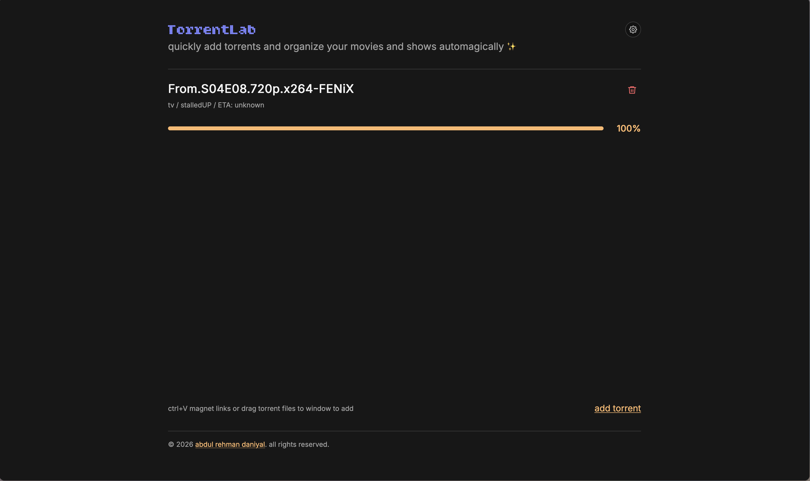

# TorrentLab

TorrentLab is a lightweight web UI for qBittorrent in a home lab. It adds magnet links or `.torrent` files, shows torrent progress, and moves completed downloads into movie, TV, ebook, and comic library folders.

The container includes the Go API and the built Svelte frontend. qBittorrent runs as a separate container or service.

## Screenshot


## Quick Start

Create a `docker-compose.yml`:

```yaml
services:
  qbittorrent:
    image: lscr.io/linuxserver/qbittorrent:latest
    container_name: qbittorrent
    environment:
      PUID: 1000
      PGID: 1000
      UMASK: "002"
      TZ: Etc/UTC
      WEBUI_PORT: 4000
      TORRENTING_PORT: 6881
    ports:
      - "4000:4000"
      - "6881:6881"
      - "6881:6881/udp"
    volumes:
      - ./data/qbittorrent/config:/config
      - ./data/media/movies:/media/movies
      - ./data/media/tv:/media/tv
      - ./data/media/books:/media/books
      - ./data/media/comics:/media/comics
      - ./data/torrents/incomplete:/torrents/incomplete
      - ./data/torrents/downloads:/torrents/downloads
    restart: unless-stopped

  torrentlab:
    image: ghcr.io/abdul-rehman-d/torrent-lab:latest
    container_name: torrentlab
    environment:
      PUID: 1000
      PGID: 1000
      UMASK: "002"
      CONFIG_DIR: /config
      MOVIES_PATH: /media/movies
      TV_PATH: /media/tv
      BOOKS_PATH: /media/books
      COMICS_PATH: /media/comics
      INCOMPLETE_PATH: /torrents/incomplete
      DOWNLOADS_PATH: /torrents/downloads
      PORT: 5000
    ports:
      - "5000:5000"
    volumes:
      - ./data/config:/config
      - ./data/media/movies:/media/movies
      - ./data/media/tv:/media/tv
      - ./data/media/books:/media/books
      - ./data/media/comics:/media/comics
      - ./data/torrents/incomplete:/torrents/incomplete
      - ./data/torrents/downloads:/torrents/downloads
    depends_on:
      - qbittorrent
    restart: unless-stopped
```

Start the stack:

```sh
docker compose up -d
```

Open TorrentLab at `http://localhost:5000`.

Open qBittorrent at `http://localhost:4000`.

On first boot, qBittorrent may print a temporary admin password in its container logs. Log in to qBittorrent, set the credentials you want, then configure TorrentLab to use:

```txt
URL: http://qbittorrent:4000
Username: your-qbittorrent-username
Password: your-qbittorrent-password
```

## Image Tags

Images are published to GitHub Container Registry by the Docker Image workflow.

```txt
ghcr.io/abdul-rehman-d/torrent-lab:latest
ghcr.io/abdul-rehman-d/torrent-lab:master
ghcr.io/abdul-rehman-d/torrent-lab:sha-<commit>
ghcr.io/abdul-rehman-d/torrent-lab:<version>
```

`latest` is published from the default branch. Version tags are published when a Git tag like `v1.2.3` is pushed.

## Configuration

TorrentLab stores qBittorrent connection settings in `qbit.json` under `CONFIG_DIR`. In the Compose example, that file is stored at `./data/config/qbit.json`.

| Variable          | Default                     | Description                                                                       |
| ----------------- | --------------------------- | --------------------------------------------------------------------------------- |
| `PUID`            | `1000`                      | User ID used to run TorrentLab and write `CONFIG_DIR`.                            |
| `PGID`            | `1000`                      | Group ID used to run TorrentLab and write `CONFIG_DIR`.                           |
| `UMASK`           | `002`                       | File creation mask used by TorrentLab-created directories.                        |
| `PORT`            | `5000`                      | HTTP port inside the TorrentLab container.                                        |
| `CONFIG_DIR`      | `./config`                  | Directory where TorrentLab stores `qbit.json`. Use `/config` in Docker.           |
| `WEB_DIR`         | `./web`                     | Directory containing the built frontend. The published image sets this to `/web`. |
| `MOVIES_PATH`     | `/data/media/movies`        | Movie library path visible inside the TorrentLab container.                       |
| `TV_PATH`         | `/data/media/tv`            | TV library path visible inside the TorrentLab container.                          |
| `BOOKS_PATH`      | `/data/media/books`         | Ebook library path visible inside the TorrentLab container.                        |
| `COMICS_PATH`     | `/data/media/comics`        | Comics library path visible inside the TorrentLab container.                       |
| `INCOMPLETE_PATH` | `/data/torrents/incomplete` | Incomplete download path. Keep this aligned with qBittorrent.                     |
| `DOWNLOADS_PATH`  | `/data/torrents/downloads`  | Completed download path. Keep this aligned with qBittorrent.                      |

The path variables must point to paths that both TorrentLab and qBittorrent can access. The host paths may be different, but the mounted container paths should match the values configured in TorrentLab and qBittorrent.

## qBittorrent Settings

For the Compose example above, set qBittorrent's paths to:

| Setting              | Value                  |
| -------------------- | ---------------------- |
| Web UI port          | `4000`                 |
| Incomplete downloads | `/torrents/incomplete` |
| Default save path    | `/torrents/downloads`  |

When TorrentLab and qBittorrent are in the same Compose file, use `http://qbittorrent:4000` as the qBittorrent URL. Do not use `localhost` from inside the TorrentLab container.

## Behavior

TorrentLab adds magnet links and torrent files to qBittorrent using the configured downloads path. The UI and API are served from the same port, with API routes under `/api`. For torrents whose title does not reveal the media type, TorrentLab checks qBittorrent's file list as soon as torrent metadata is available and labels the item from its file extensions. While magnet metadata is still loading, the UI shows `checking files`.

Completed movie, TV, and ebook torrents are moved through qBittorrent's `setLocation` API, so qBittorrent keeps seeding from their library paths. Comics stay in the downloads folder for seeding; TorrentLab creates a Kavita-ready series folder under the comic library and hard-links each archive there, falling back to a copy if the storage mounts do not allow hard links. Manual removal removes the torrent from qBittorrent without deleting files.

TV detection uses `S01` or `S01E01` style filename markers. TV files are moved under `TV_PATH`, and video files are moved under `MOVIES_PATH`. EPUB files are moved under `BOOKS_PATH`. PDF/CBZ/CBR/CB7/CBT files are organized automatically under `COMICS_PATH/<series>/` using the torrent file list. TorrentLab derives the series folder from the filename before a volume or issue marker and keeps each original archive filename intact, so Kavita receives the series-folder layout without manual cleanup.

Kavita's library roots should be the books and comics folders. Organize ebooks in series folders when they belong together, and set their EPUB metadata (title, author, and series/series index when relevant). For comics, keep each series in its own folder and use Kavita-readable issue or volume markers in filenames, for example:

```text
comics/
  Saga/
    Saga v01.cbz
    Saga v02.cbz
  Batman (2016)/
    Batman (2016) #001.cbz
```

TorrentLab can place comic files in a folder based on the torrent's name, but it does not infer series/issue metadata or rename archive contents. Review multi-file comic torrents and arrange them into Kavita's recommended series/volume layout before scanning. Keep torrent and media paths mounted identically in qBittorrent and TorrentLab so completed torrents can continue seeding after they are moved.

## Local Testing

This repository includes a local Compose file that builds the image from source:

```sh
docker compose -f testing-docker-compose.yml up --build
```

The test stack stores data under `./data`.

## Development

Build the frontend before running the backend locally:

```sh
cd frontend
npm install
npm run build
```

Run the backend:

```sh
cd backend
go test ./...
WEB_DIR=../frontend/build CONFIG_DIR=../data/config go run ./cmd/server
```

Useful API endpoints:

```txt
GET /api/health
GET /api/config
PUT /api/config/qbit
POST /api/restart
```
